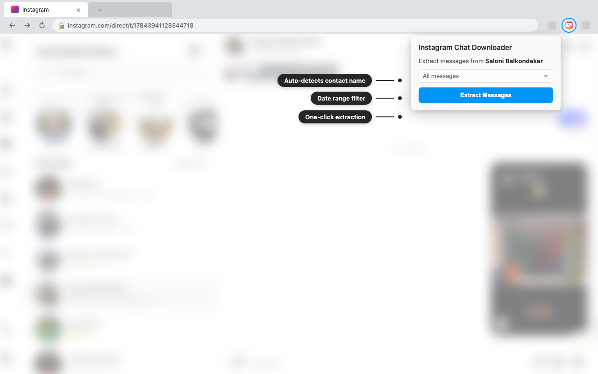
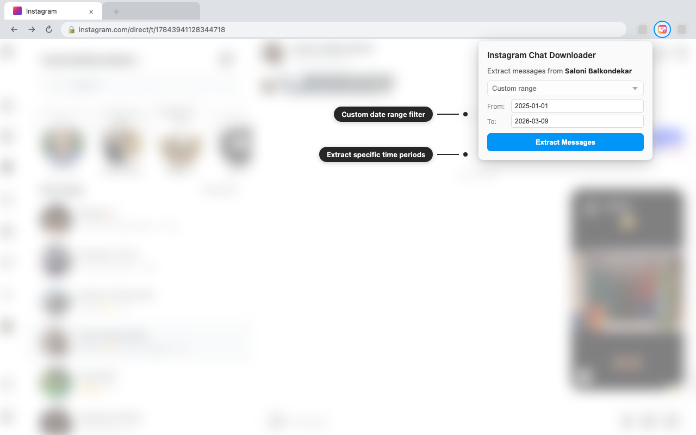
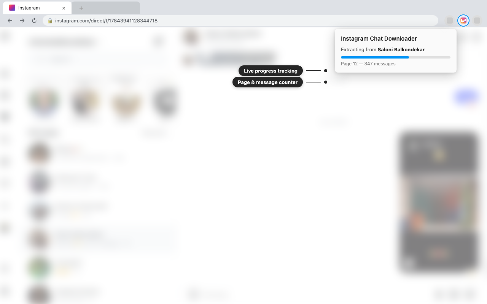
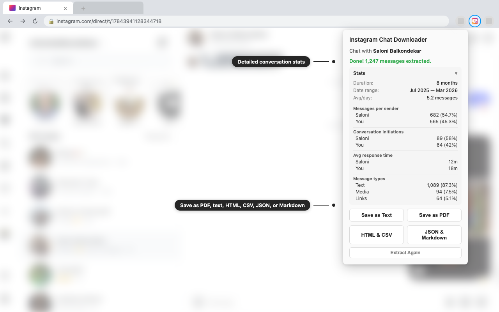

# DMVault - Instagram Chat Downloader & DM Export

Download an Instagram conversation as PDF, plain text, HTML, CSV, JSON, or Markdown. The Chrome and Firefox extension uses your existing Instagram session and creates each export locally in your browser.

  
  
  
  

***

  <a href="https://github.com/Axnm0l/DMVault"> <strong>DMVault on GitHub</strong></a>

***

## Features

| Feature | Description |
|---|---|
| **Chat name resolution** | Shows the contact name before extraction — no cryptic thread IDs |
| **Date filtering** | All messages, past 1/7/30 days, or a custom range |
| **Adaptive speed** | Starts fast, backs off on rate limits |
| **Stats** | Per-sender counts, response times, conversation initiations, message types |
| **Six export formats** | PDF, plain text, styled HTML, CSV, JSON, and Markdown |
| **Permanent shared links** | Keeps links to shared posts, reels, and profiles in the export |
| **Local export** | The developer does not receive your account or conversation data |

## Screenshots

<table>
  <tr>
    <td align="center"> <em>Open a DM and click Extract</em></td>
    <td align="center"> <em>Filter by custom date range</em></td>
  </tr>
  <tr>
    <td align="center"> <em>Live progress tracking</em></td>
    <td align="center"> <em>Conversation stats and export</em></td>
  </tr>
</table>

## Install (development)

**Chrome / Chromium:**
1. Clone this repo
2. Go to `chrome://extensions` → enable **Developer mode**
3. **Load unpacked** → select the `extension/` folder

**Firefox:**
1. Go to `about:debugging#/runtime/this-firefox`
2. **Load Temporary Add-on** → select `extension/manifest.json`

## Usage

1. Open a DM conversation on [instagram.com](https://www.instagram.com)
2. Click the extension icon
3. Pick a date range → **Extract Messages**
4. Save the chat as **PDF**, **Text**, **HTML**, **CSV**, **JSON**, or **Markdown**

## How it works

Uses Instagram's web DM API (`/api/v1/direct_v2/threads/`), the same API that the web app uses. It uses your existing Instagram session, paginates through messages, parses 15+ message types, and exports locally. **The developer does not receive your account or conversation data.**

## Privacy

The extension processes the selected conversation in your browser. Exported HTML or PDF files can request message media from Meta hosts or Giphy when opened. See the [privacy policy](docs/PRIVACY.md) for the data types, local PDF storage, retention, permissions, and Limited Use terms.

## License

[MIT](LICENSE)
